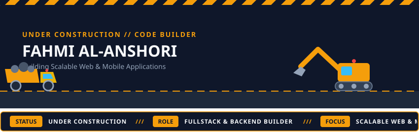
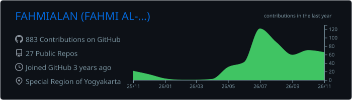
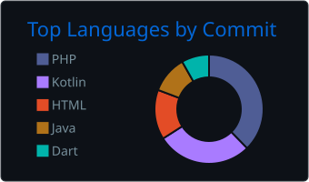
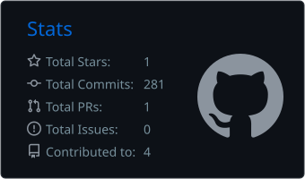
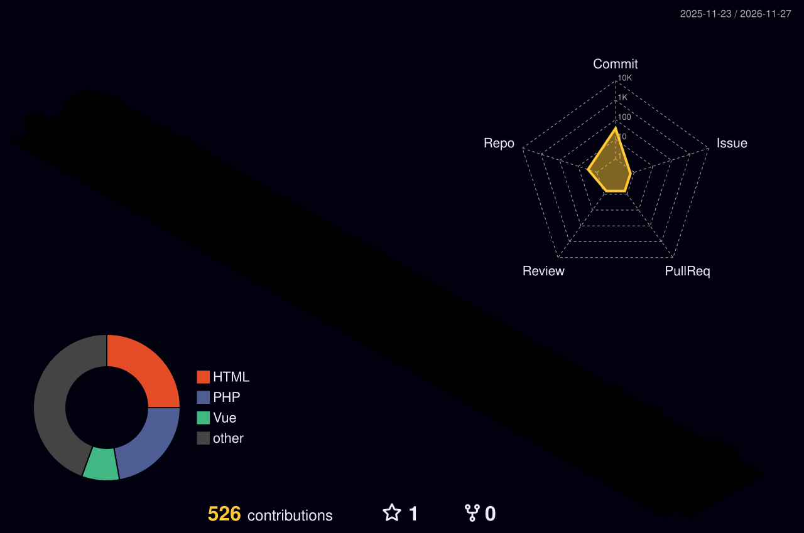

<!-- 1. Banner Animasi Builder (Excavator & Truk) -->

  

<!-- 2. Typing Animation -->

  

---

### 🏗️ About Me
- 👷‍♂️ **Backend & Fullstack Developer** focused on building scalable web and mobile applications.
- ⚙️ Experienced in **RESTful API architecture**, database design, and enterprise web systems.
- 📍 Based in **Special Region of Yogyakarta, Indonesia**.
- 🚧 Always building, optimizing, and shipping clean production code.

---

### 🧰 Tech Stack & Heavy Machinery

#### 💻 Languages & Backend

  
  
  
  
  
  

#### 🚀 Frameworks & Libraries

  
  
  
  
  
  
  

#### 🗄️ Databases

  
  

#### 🛠️ Environment & Tools

  
  
  
  

---

### 📊 GitHub Statistics

  

  
  

  

---

### 🐍 GitHub Contribution Snake Animation

  

---

### 🧊 3D Contribution Graph

  

---

### 🤝 Connect With Me

  
  

